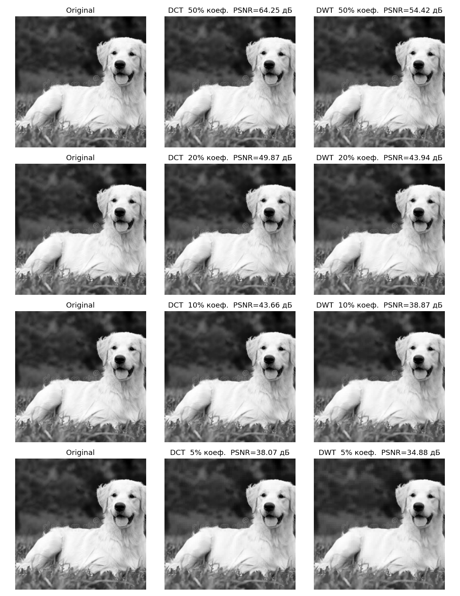
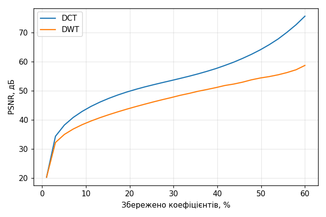
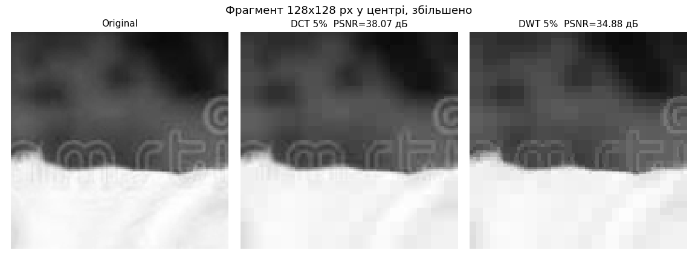
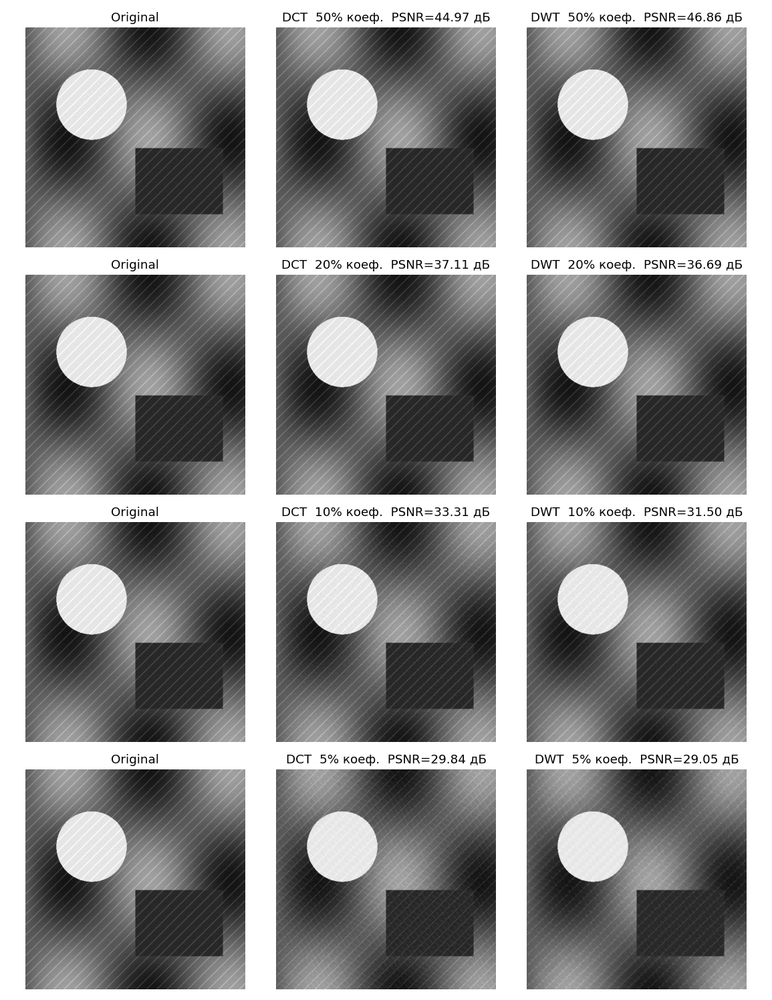
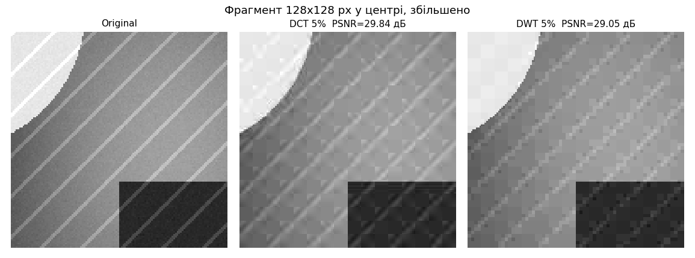

# Лабораторна робота №3. Стиснення зображень з втратами: DCT vs DWT (Хаар)

Програма стискає зображення у відтінках сірого (512×512) двома методами: дискретним косинусним перетворенням (DCT) і дискретним вейвлет-перетворенням Хаара (DWT). Результати показуються поряд (Original | DCT | DWT) разом зі значеннями PSNR.

## Запуск

```bash
pip install numpy pillow matplotlib

python compress_lab.py my_photo.jpg            # інтерактивне вікно з повзунком рівня стиснення
python compress_lab.py                         # те саме на синтетичному тестовому зображенні
python compress_lab.py my_photo.jpg --report   # таблиця в консоль + картинки і CSV у results/
python compress_lab.py --selftest              # перевірка коректності перетворень
```

Додаткові параметри: `--size` (розмір після масштабування, кратний 8 і 2^levels), `--levels` (кількість рівнів DWT, за замовчуванням 3), `--out` (папка для звіту), `--keep-jpeg-grid` (див. розділ про JPEG нижче).

## Реалізація

Усі перетворення написані вручну. NumPy використовується лише для масивів і множення матриць; готові функції `dct`/`idct`/`dwt`/`idwt` (scipy, pywt, OpenCV) не використовуються.

**DCT.** Зображення розбивається на блоки 8×8, від значень віднімається 128. Будується ортонормована матриця DCT-II:

C[k, j] = a(k) · cos((2j + 1)kπ / 16), де a(0) = √(1/8), a(k) = √(2/8).

Пряме перетворення блока: **D = C · B · Cᵀ**, обернене: **B = Cᵀ · D · C** (бо C ортогональна, C⁻¹ = Cᵀ). Множення виконується одразу для всіх блоків.

**DWT Хаара.** Ортонормований одновимірний крок: низькочастотна частина (a + b)/√2, високочастотна (a − b)/√2. Двовимірне перетворення — спочатку по рядках, потім по стовпцях. Розкладка Маллата: на кожному наступному рівні перетворюється лише LL-квадрант (лівий верхній). Використовується 3 рівні. Обернене перетворення виконує ті самі кроки у зворотному порядку.

**Стиснення.** Залишається задана частка найбільших за модулем коефіцієнтів усього зображення (глобальний thresholding), решта обнуляється. Рівень стиснення змінюється повзунком у вікні (1–100 %) або списком рівнів у режимі `--report` (50, 20, 10, 5 %). Обидва методи отримують однакову кількість коефіцієнтів, тож порівняння чесне.

**Метрики.**
- PSNR = 10 · log₁₀(255² / MSE), рахується між оригіналом і відновленим зображенням після округлення до 0..255.
- Коефіцієнт стиснення = (усього коефіцієнтів) / (збережених ненульових). Це **теоретична** оцінка: реальний розмір файлу був би більшим, бо треба ще зберігати позиції ненульових коефіцієнтів і кодувати їхні значення (квантування + ентропійне кодування). Тому ця величина придатна для порівняння методів між собою, а не для порівняння з розміром JPEG-файлу.

**Самоперевірка (`--selftest`)** перевіряє: ортогональність матриці DCT; збіг матричного DCT з формулою DCT-II через подвійну суму; точне відновлення DCT→IDCT і Хаар→обернений Хаар (1–3 рівні) без відкидання коефіцієнтів; збереження енергії; поведінку на константному зображенні; коректність `keep_largest`; формулу PSNR; спадання PSNR зі зменшенням частки коефіцієнтів.

## Важливо: чому з JPEG треба зсувати сітку

Тестове фото `my_photo.jpg` — JPEG розміром рівно 512×512. JPEG уже стиснутий **тим самим DCT 8×8**, і його квантування обнулило більшість високочастотних коефіцієнтів. Якщо подати такий файл без змін, блоки 8×8 у програмі точно збігаються з блоками JPEG, і DCT отримує зображення, яке вже розріджене саме в його базисі. Порівняння з DWT тоді нечесне.

Це видно з цифр (частка коефіцієнтів з |c| < 0.5 ще **до** нашого стиснення і PSNR при збереженні 50 %):

| Варіант | DCT: |c|<0.5 | DWT: |c|<0.5 | PSNR DCT, 50 % | PSNR DWT, 50 % |
|---|---|---|---|---|
| Сітка збігається з JPEG (`--keep-jpeg-grid`) | 71.5 % | 35.6 % | **94.53 дБ** | 54.77 дБ |
| Сітка зсунута (за замовчуванням) | 45.1 % | 33.7 % | 64.25 дБ | 54.42 дБ |

94.5 дБ означає практично ідеальне відновлення, тобто відкинуті коефіцієнти й так були нулями. Тому програма тепер за замовчуванням обрізає з JPEG по 4 px з кожного краю (зсув на півблока) і лише потім масштабує до 512×512. Для DWT різниці майже немає, бо Хаар не «бачить» сітку JPEG. При сильному стисненні (5–10 %) ефект зникає: 38.00 і 38.07 дБ при 5 %.

Додатково всі експерименти повторено на **синтетичному** зображенні, яке ніколи не стискалося: плавні градієнти, коло і прямокутник із різкими краями, діагональні смуги (висока частота) і шум.

## Результати експериментів

### Фото (`my_photo.jpg`, сітка зсунута)

| Збережено коефіцієнтів | К-сть коефіцієнтів (з 262 144) | Коеф. стиснення | PSNR DCT, дБ | PSNR DWT, дБ |
|---|---|---|---|---|
| 50 % | 131 072 | 2× | 64.25 | 54.42 |
| 20 % | 52 429 | 5× | 49.87 | 43.94 |
| 10 % | 26 214 | 10× | 43.66 | 38.87 |
| 5 % | 13 107 | 20× | 38.07 | 34.88 |







### Синтетичне зображення

| Збережено коефіцієнтів | К-сть коефіцієнтів (з 262 144) | Коеф. стиснення | PSNR DCT, дБ | PSNR DWT, дБ |
|---|---|---|---|---|
| 50 % | 131 072 | 2× | 44.97 | **46.86** |
| 20 % | 52 429 | 5× | 37.11 | 36.69 |
| 10 % | 26 214 | 10× | 33.31 | 31.50 |
| 5 % | 13 107 | 20× | 29.84 | 29.05 |





### Візуальна якість

- **50 % і 20 %** — обидва методи візуально не відрізняються від оригіналу (PSNR > 40 дБ на фото).
- **10 %** — на фото втрати ще малопомітні. На синтетичному зображенні з’являються дрібні артефакти біля діагональних смуг.
- **5 %** — артефакти помітні на збільшеному фрагменті, і вони різні за характером:
  - **DCT:** блочність 8×8 у плавних областях (фон, шерсть) і легкий «дзвін» (ringing) біля різких країв. Загалом зображення лишається плавним.
  - **DWT (Хаар):** «мозаїка» з квадратних сходинок. Базисні функції Хаара кусково-сталі, тому після відкидання деталей зображення складається з однотонних квадратів (при 3 рівнях — розміром до 8×8). Край кола і смуги стають ступінчастими, градієнти — смугастими.

## Висновки

1. Обидва перетворення реалізовано правильно: без відкидання коефіцієнтів відновлення точне (похибка ~10⁻¹³), енергія зберігається, тож уся втрата якості пов’язана лише з відкиданням коефіцієнтів.
2. **На фото DCT стабільно кращий за PSNR**: на 3–10 дБ при однаковій кількості збережених коефіцієнтів. Фото має великі плавні області (розмитий фон, шерсть), які DCT стискає дуже ефективно: плавний сигнал у блоці 8×8 описується кількома низькочастотними косинусами. Кусково-стала апроксимація Хаара для плавних переходів гірша.
3. **На синтетичному зображенні методи майже рівні**. При слабкому стисненні (50 %) DWT навіть трохи кращий: шум і різкі краї DCT-блоки розмазують по всіх коефіцієнтах блока, а Хаар локалізує їх у малій кількості коефіцієнтів. При сильнішому стисненні DCT знову виграє на 0.4–1.8 дБ. Тобто перевага методу залежить від змісту зображення: плавні області на користь DCT, різкі вертикальні/горизонтальні межі — на користь Хаара.
4. **Характер артефактів різний**: DCT дає блочність і ringing, Хаар — квадратну «мозаїку». При близькому PSNR візуальне сприйняття може відрізнятися, тому PSNR варто доповнювати оглядом зображень.
5. **Вейвлет Хаара — найпростіший вейвлет**, і саме його кусково-стала форма зумовлює гірший результат на плавних фото. Гладші вейвлети (наприклад, CDF 9/7 у JPEG 2000) зазвичай перевершують блочне DCT, бо не мають ні блочності, ні сходинок.
6. **Методичний висновок**: тестувати DCT-стиснення на JPEG, розмір якого кратний 8 і не змінюється, некоректно. Сітка блоків збігається з JPEG, і PSNR DCT штучно завищується (94.5 дБ замість 64.3 дБ при 50 %). Для чесного порівняння потрібне зображення без JPEG-історії або зсув сітки.
7. Коефіцієнт стиснення у звіті показує лише частку ненульових коефіцієнтів. Реальний виграш у розмірі файлу менший, бо треба кодувати позиції коефіцієнтів і їхні значення.
